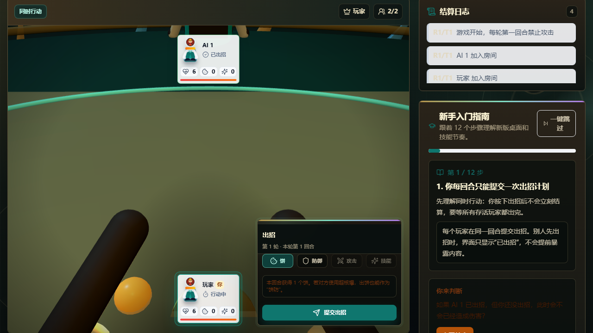
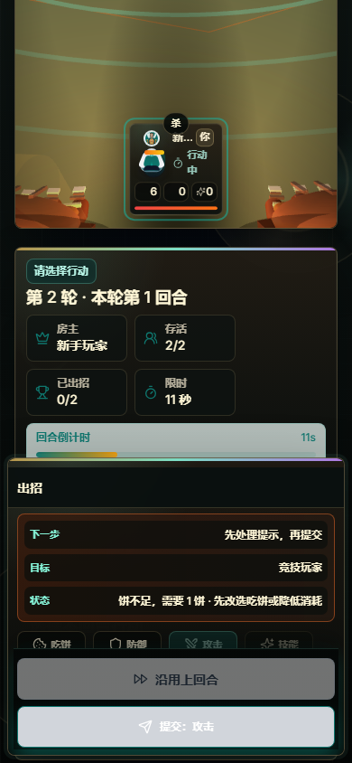

# BING Game / 饼

<p align="center">
  <strong>一款“同时出招、统一亮牌结算”的多人卡牌策略游戏。</strong>
</p>

<p align="center">
  <a href="#快速开始">快速开始</a>
  ·
  <a href="#公网联机">公网联机</a>
  ·
  <a href="#美术与动画方向">美术与动画方向</a>
  ·
  <a href="#常用命令">常用命令</a>
  ·
  <a href="#文档入口">文档入口</a>
</p>

<p align="center">
  
  
  
  
  
</p>

<p align="center">
  
</p>

## 项目简介

`饼` 是一个原创回合制卡牌策略游戏。每位玩家在同一回合暗中选择行动，服务端再统一亮牌并结算：吃饼、防御、攻击、反弹、技能、伤害和死亡都会在同一个节奏里被处理。

当前仓库包含：

- React / Vite / Three.js 客户端，包含 3D 牌桌、玩家座位、行动面板、技能画廊、复盘和新手引导。
- Express / Socket.IO 服务端，负责房间、状态机、回合结算、复盘记录和训练样本导出。
- `packages/shared` 共享规则包，统一动作、技能、状态、socket 类型和回合时间线。
- 自动 playtest agents，用真实浏览器开房、出招、观战、重连、超时兜底并生成报告。
- Seedance 动画任务脚本和全技能特效文档，正在把技能特效从 CSS 光效升级为油画/装置感动画资产。

## 截图

<p align="center">
  
</p>

## 当前状态

| 模块 | 状态 |
| --- | --- |
| 核心玩法 | 双玩家创建房间、加入房间、开局、出招、沿用上回合、攻击和结算 happy path 已通过 UI agent。 |
| UI/HUD | 3D 牌桌、行动面板、目标预览、结算摘要、血量/饼变化和技能画廊已接入；仍在继续做油画感和轻量化打磨。 |
| 角色资产 | 6 个默认角色有头像、移动端头像、动作姿态图和 GLB 管线；美术方向已转向手绘搞怪动物，GLB 仍是 WIP/blockout。 |
| 特效资产 | `docs/EFFECT_ANIMATION_PROMPTS.json` 已覆盖 120 个技能、480 张关键帧 prompt 和 120 条 Seedance prompt；实际 mp4/webm 动画仍在生成阶段。 |
| 自动化验收 | 覆盖规则回归、角色资产审计、turn timeline、UI agents、复杂技能、重连、超时和提交 metadata smoke。 |
| 发布边界 | 当前是私有项目。公开发布前需要确认素材来源、授权、长期部署和公网联机门禁。 |

## 快速开始

```bash
npm install
npm run dev
```

本地地址：

- 前端：[http://localhost:5173](http://localhost:5173)
- 后端：[http://localhost:3001](http://localhost:3001)

## 公网联机

临时开一个公网多人房间：

```bash
npm run public
```

这个命令会构建项目、启动生产服务，并通过 Cloudflare Tunnel 暴露本机 `3001` 端口。游玩期间请保持终端窗口打开。

如果已经构建过，可以跳过构建：

```bash
npm run public:no-build
```

更多说明见 [公网联机](docs/PUBLIC_PLAY.md) 和 [部署说明](docs/DEPLOYMENT.md)。

## 美术与动画方向

当前视觉目标是“油画纸面 + 透明装置 + 手绘动物角色”：

- 页面元素要轻薄，避免塑料感、硬方框和后台 dashboard 感。
- 头像和玩家信息框采用手绘角色、纸面纹理、低饱和色和不规则边缘。
- 技能和介绍界面做成 gallery，展示一张张技能卡片。
- 技能特效以 `docs/EFFECT_ANIMATION_PROMPTS.json` 为准，每个技能 4 张关键帧，再用 Seedance 补成短动画。
- paid API 调用有预算闸门：预计达到或超过 10 RMB 时必须先确认。

相关文档：

- [视觉圣经](workflow/docs/01-visual-bible.md)
- [UI 设计方案](docs/UI_DESIGN_PLAN.md)
- [全技能特效状态](docs/EFFECT_ASSET_STATUS.md)
- [油画特效生产线](workflow/tasks/TASK-007-oil-paint-effect-pipeline.md)
- [Seedance MCP / API 配置](docs/SEEDANCE_MCP_SETUP.md)
- [角色资产审计](docs/CHARACTER_ASSET_AUDIT.md)
- [资产权属与来源说明](docs/ASSET_RIGHTS.md)

## 子智能体协作

仓库使用功能命名的 BING 子智能体，而不是泛名角色。当前核心职责包括：

- 美术总监：检查油画感、字体、透明度、色彩、头像和整体美术一致性。
- 动画设计：拆解技能关键帧、Seedance prompt、节奏、遮挡和 reduced-motion 回退。
- 文学总监：修正界面文案、README、引导文本和气质表达，不改技能名和原机制。
- 产品经理：检查主流程、信息层级、可理解性和发布优先级。
- 新手玩家 / 竞技玩家：分别从学习成本和对抗读局角度做 playtest。
- 开发商 QA：负责 smoke、回归、截图、控制台错误和发布风险。
- 公网部署：负责本地/公网联机、隧道、端口和部署文档。

完整名单见 [BING 子智能体名册](docs/SUBAGENT_ROSTER.md)。

## 常用命令

| 命令 | 用途 |
| --- | --- |
| `npm run dev` | 同时启动客户端和服务端开发服务。 |
| `npm run build` | 构建 shared、server 和 client。 |
| `npm run serve` | 启动生产模式服务。 |
| `npm run public` | 构建并打开临时公网联机地址。 |
| `npm run typecheck` | 对所有 workspace 运行 TypeScript 检查。 |
| `npm run test:ci` | 运行 typecheck、资产审计、规则回归和 turn timeline 检查。 |
| `npm run verify` | 构建后运行核心检查和默认 UI agents。 |
| `npm run verify:release` | 发布前完整门禁。 |
| `npm run test:assets` | 检查 6 个角色的 GLB、头像、QA 图和 PBR 贴图资源。 |
| `npm run test:effect-assets` | 检查 120 个技能的关键帧、poster、webm 和 mp4 是否齐全且格式有效。 |
| `npm run test:ui-agents` | 构建 client 后运行默认双玩家浏览器 playtest。 |
| `npm run test:ui-agents:complex` | 运行复杂技能 smoke。 |
| `npm run test:ui-agents:reconnect` | 验证房间恢复、reload 和观战重连。 |
| `npm run test:ui-agents:timeout` | 验证短限时下服务端自动兜底。 |
| `npm run effects:keyframes:plan` | 生成技能关键帧 image generation 计划，不调用 API。 |
| `npm run seedance:effects:plan` | 生成 Seedance 任务 payload，不调用 API。 |
| `npm run seedance:effects:submit -- --estimated-cny-per-task=3` | 提交 Seedance 任务；达到 10 RMB 预算线会自动停止。 |
| `npm run seedance:effects:settle` | 轮询已提交任务并下载动画资产。 |

## 项目结构

```text
apps/
  client/          React、Vite、Tailwind、Three.js 游戏界面
  server/          Express、Socket.IO、房间状态、复盘接口
packages/
  shared/          共享规则、动作、技能、socket 类型、状态机
docs/              架构、部署、公网联机、AI 训练、UI 方案、资产说明
scripts/           公网隧道、规则检查、playtest、Seedance、训练工具
tools/             Blender / MCP 辅助脚本
workflow/          制作流程、任务、prompts、review 和 playtest 模板
```

## 文档入口

- [架构说明](docs/ARCHITECTURE.md)
- [产品计划](docs/PRODUCT_PLAN.md)
- [发布清单](docs/RELEASE_CHECKLIST.md)
- [公网联机](docs/PUBLIC_PLAY.md)
- [异网联机](docs/remote-play.md)
- [AI 训练](docs/AI_TRAINING.md)
- [Playtest 报告](docs/PLAYTEST_REPORT.md)
- [子智能体 UI 评审](docs/SUBAGENT_UI_REVIEW.md)
- [BING 子智能体名册](docs/SUBAGENT_ROSTER.md)
- [Prompt + Goal 写法](workflow/prompts/prompt-goal-combos.md)
- [Game Pillars](workflow/docs/00-game-pillars.md)
- [Roadmap](workflow/docs/02-roadmap.md)

## 许可证

当前为私有项目，详见 [LICENSE](LICENSE)。素材来源、发布边界和授权注意事项见 [资产权属与来源说明](docs/ASSET_RIGHTS.md)。
