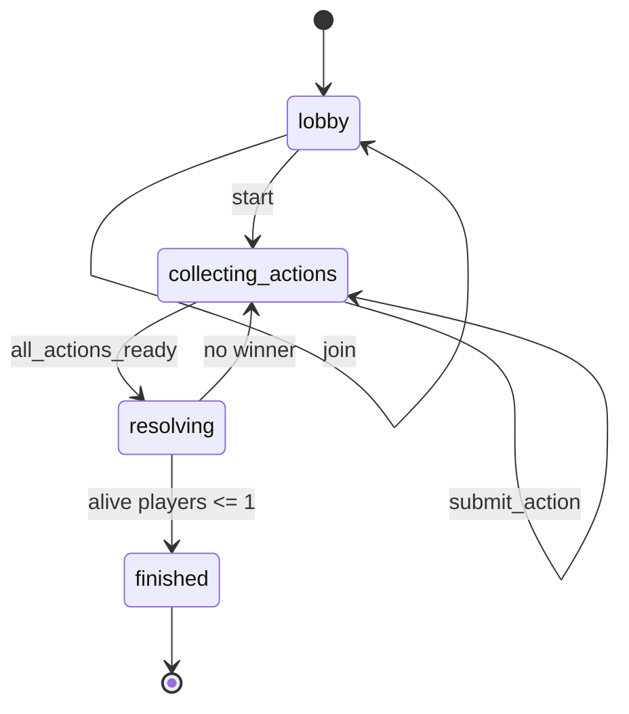
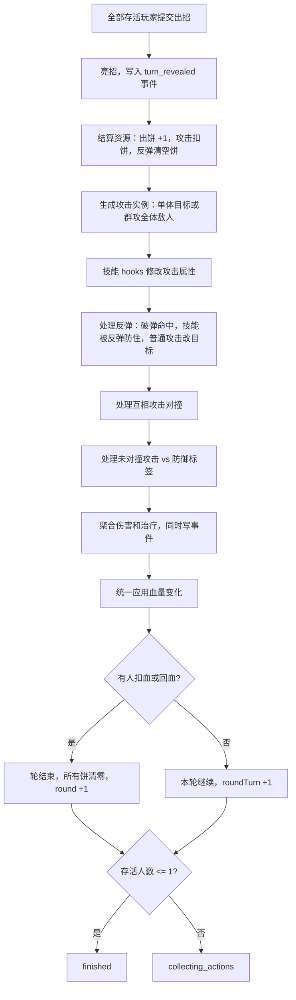

# 《饼》架构设计

## 1. 项目目录结构

```text
bing-card-game/
  apps/
    client/                 # React + TypeScript + Tailwind 前端
      src/
        components/         # 对局 UI、出招面板、日志
        lib/                # Socket 与格式化工具
    server/                 # Node.js + Express + Socket.IO 后端
      src/
        ai.ts               # AI 玩家策略入口
        roomStore.ts        # 内存房间与游戏状态管理
        index.ts            # HTTP/Socket 网关
  packages/
    shared/                 # 前后端共享强类型规则包
      src/
        engine/             # 基础攻击、校验、结算引擎
        skills/             # 技能注册表与 Excel 导入技能库
        state/              # 状态机
        replay/             # Replay 事件导出
        socket.ts           # Socket 通信契约
        types.ts            # 核心类型
  scripts/
    import-skills.py        # 从 docs/archive xlsx 导入技能表
  docs/
    ARCHITECTURE.md
```

## 2. 核心 TypeScript 类型定义

核心类型在 `packages/shared/src/types.ts`，前后端共用，避免协议漂移。

```ts
export type GamePhase = "lobby" | "collecting_actions" | "resolving" | "finished";
export type DefenseKind = "small" | "youtiao" | "stone" | "rebound";
export type DefenseTag = "small" | "youtiao" | "stone" | "any" | "cake" | "unblockable";

export interface PlayerState {
  id: PlayerId;
  name: string;
  kind: "human" | "ai";
  hp: number;
  cakes: number;
  status: "alive" | "dead";
  connected: boolean;
  skills: SkillId[];
  buffs: BuffState[];
}

export type PlayerAction =
  | { type: "gain_cake" }
  | { type: "defense"; defense: DefenseKind; targetId?: PlayerId }
  | { type: "attack"; attackId: AttackId; stacks: number; targetId?: PlayerId }
  | { type: "skill"; skillId: SkillId; stacks: number; targetId?: PlayerId };

export interface GameState {
  id: GameId;
  phase: GamePhase;
  roundNumber: number;
  roundTurnNumber: number;
  turnNumber: number;
  players: PlayerState[];
  pendingActions: Partial<Record<PlayerId, PlayerAction>>;
  eventLog: GameEvent[];
  winnerIds: PlayerId[];
  config: GameConfig;
  createdAt: number;
  updatedAt: number;
}
```

基础攻击定义在 `packages/shared/src/engine/attacks.ts`，叠加时按规则同步放大消耗、攻击力、等级。擒的基础等级是 0，所以叠加后仍然是 0。

## 3. 回合状态机



状态机代码在 `packages/shared/src/state/machine.ts`。

### 技能时点与实际推进

`skills/phases.ts` 定义技能时点的名称，`engine/resolver.ts` 负责实际推进。一回合是一次全员提交、亮招与结算；一轮可以包含多个回合。主出招结算有血量变化时，在回合末行动结束后收束本轮；无血量变化时进入同轮下一回合。轮间技能造成血量变化有单独分支，不能仅用血量变化判断所有窗口都会结束一轮。

| 时点 | 用途或当前例子 |
| --- | --- |
| 开局判定 | 初始血量、开局技能和顺手牵羊候选等初始化 |
| 轮前轮间行动 | 一轮开始前的轮间技能窗口；第一轮允许免费融合及顺手牵羊选择 |
| 轮前行动 | 本轮开始前的主动技能窗口 |
| 轮初判定 | 轮前行动结束后执行独裁、遗计、延迟加饼等轮初效果 |
| 回合前行动 | 每次出招前的主动技能窗口 |
| 回合初判定 | 回合前行动结束后执行圣水收集器、固定出招等回合初处理 |
| 出招阶段 | 玩家提交本回合的出饼、攻击、防御或技能出招 |
| 亮招判定 | 全员提交后公布出招并结算资源 |
| 变招阶段 | 换防、虚幻、双刃剑、绝对守护、毁灭之力等反应窗口 |
| 命中判定 | 实际攻击中的领域、反弹、对撞、防御、免疫及命中效果 |
| 变伤阶段 | 有合法伤害修正技能时，开放十字守护、斗转星移、六芒星等窗口 |
| 伤害判定 | 伤害规则计算与最终血量应用；部分减免已在伤害进入变伤队列前计算 |
| 复活阶段 | 有待处理死亡时开放合法复活技能窗口；部分被动复活立即处理 |
| 回合末行动 | 伤害与复活处理后的主动技能窗口；允许分解融合技能 |
| 回合末判定 | 回合收尾的时点标签；当前主流程未为此单独设置停留窗口或统一技能钩子 |
| 回合后间隙 | 本轮继续时，下一次回合前行动之前的技能窗口 |
| 轮末判定 | 本轮结束时执行圣域、邪域等效果，随后清饼、处理克己、解除轮末失效状态并推进轮数 |
| 轮后轮间行动 | 已定义的轮间时点；当前正常轮末分支直接进入下一轮的轮前轮间行动 |
| 锁定／被动 | 事件驱动的触发类别，不是所有玩家依次进入的独立阶段 |

自动判定标签不都单独写入 `activeTimingPhase`，也不都构成可操作窗口。圣域在 `endRound → applyRoundEndSkills` 中执行，属于轮末判定，不能与每回合的回合末判定混用。正常分支在回合末行动后，有血量变化则执行轮末结算并进入下一轮轮前轮间行动，否则进入同轮回合后间隙。

## 4. 结算流程图



结算主入口是 `submitPlayerAction` 与 `resolveTurn`，位于 `packages/shared/src/engine/resolver.ts`。

## 5. Socket 通信设计

通信契约在 `packages/shared/src/socket.ts`。

| 方向 | 事件 | 作用 |
| --- | --- | --- |
| Client -> Server | `room:create` | 创建房间并绑定当前 socket 的玩家身份 |
| Client -> Server | `room:join` | 加入房间 |
| Client -> Server | `room:add_ai` | 在 lobby 加入 AI 玩家 |
| Client -> Server | `game:start` | 从 lobby 进入收招阶段 |
| Client -> Server | `game:submit_action` | 提交本回合出招 |
| Server -> Client | `room:state` | 广播公开游戏状态，只暴露已提交玩家 id，不泄露未亮出的动作 |
| Server -> Client | `room:error` | 推送错误 |

## 6. 技能系统扩展方案

Excel 技能表已通过 `scripts/import-skills.py` 导入为 `RAW_SKILL_CATALOG`。当前每条技能都有稳定 id、名称、融合方法、描述、标签和来源行号。

融合源数据位于 `docs/archive/技能规范化（v3）.xlsx` 的 Sheet2。导入脚本生成独立的 `generatedFusionCatalog.ts`，保留原基础技能 ID，并为融合产物生成独立 ID。72 条配方均可检索，当前开放 49 条；未完成效果的配方不能提交融合。

| 融合 | 已实现效果 |
| --- | --- |
| 交流电、幻境双罩、生死符 | 电击增加 1 次、两种罩各增加 2 次、万箭破弹，保留原素材效果 |
| 极寒风暴 | 狂风骤雪对每个目标造成两段各 2 点伤害，仍共享原来的 2 次上限 |
| 毁灭之盾 | 全力一击基础等级改为 0，被防住反噬 1 血；保留后盾 |
| 神之子 | 天佑之魂按 `abs(hp) * 3 + 6` 结算，保留沐浴圣光 |
| 泣血之刃 | 嗜血回复每次攻击伤害的一半，向下取整；第 4 次复仇胜利 |
| 末世 | 嗜血同上；毁灭之力缩短至每轮 1 次 |
| 风语之森 | 净化之风对所有其他存活玩家各造成 1 点法伤，保留净化免疫和原使用次数 |
| 血魔之怒 | 血水屏障增加 6 防御值；凝血之力移除 4 饼上限，保留原使用次数和轮间限制 |
| 神界炼魂 | 百炼成神的累计攻击要求降至 20 次，原血量条件不变；融合素材中的水晶额外加 1 最终等级 |
| 宗师之力 | 毁灭之力缩短至每轮 1 次；仅被该次毁灭之力修正的攻击无视破地之力 |
| 魔女斗篷 | 暗影盾增加 10 防御值，血水屏障增加 6 防御值；原保护效果和次数不变 |
| 烽火赤壁 | 火烧大地增加 2 次上限；净化之风对所有其他玩家分别造成两段各 1 点法伤 |
| 神域之种 | 神之庇护延长至每轮前 3 回合，融合素材中的水晶提供 2 等级 |
| 虚无 | 闪现缩短至每轮 1 次 |
| 空之轨迹 | 闪现缩短至每 2 轮 1 次，过往时空增加 1 次上限，每次进入小空间 3 轮 |
| 霸者重装 | 圣域每轮触发；融合素材创伤聚合的延迟回血变为 4，轮初加饼和 3 轮等待不变 |
| 冰霜长矛 | 霜落大地自己加 8、他人加 2；寒冰剑保留攻击伤害并使目标技能失效 |
| 水火双生 | 每重杀变为 3 攻、3 级、冰火双属性；寒冰剑保留攻击伤害 |
| 雷霆之心 | 大地之心每次电系免疫回复 4 血，三千雷动目标包含施放者 |
| 逆转星移 | 斗转星移可转移不超过无限的伤害，仍保留原 2 次限制和防循环标识 |
| 斗战胜佛 | 新增金箍棒：3 饼、攻无限、3 级、任意防；保留齐天大圣与火眼金睛 |
| 冰火两仪眼 | 加 4 血、造成冰火伤害并移除其他玩家的冰火素材；每次同时记入火烧和霜落次数，继承已用次数 |
| 虚幻 | 用 1 饼在小防与油条、油条与石头之间切换，替代两种素材控制技 |
| 暗影狙击 | 补刀命中零饼目标时使其退游 |
| 暗影战斧 | 他人每次受伤后按四分之一向下取整回血，自己的伤害不触发 |
| 后羿•七日连珠 | 日命中获得免费日机会，提交时显式指定免费重数；全回合合计校验、防重复花费 |
| 圣灵觉醒 | x 饼获得 4x 饼；受攻击首次归零，已为零时后续伤害照常计算 |
| 阳光之夜 | 两种领域仅作用于自身发出和受到的攻击，额外普通领域副本仍保持全场范围 |
| 破天圣剑 | 忽略配方列明的保护；双刃剑可选 -2 血为指定攻击破弹，保留普通破防选项 |
| 破军 | 双刃剑可选 -1 血群破防；对不低于初始血量一半的目标加 1 攻击伤害 |
| 无尽战刃 | 服务端对实际有限攻击伤害做 1/2 暴击判定，法术伤害不触发 |
| 天火之狱 | 非火系致死时浴火重生消耗 3 饼，地狱主宰自救保留技能、融合和累计次数 |
| 山崩地裂 | 3 饼、5 攻、5 级、饼防；目标出石头时改为退游效果 |
| 绝对天盾 | 绝对守护耗饼按 x/3 下取整，额外可将群攻改为指向天 |
| 神域守护 | 绝对守护耗饼按 x/4 下取整，护佑除 3 下取整、十字乘 3 |
| 黑白板 | 符合胜利人数条件的人数不超过 3 时触发胜利 |
| 冰火双漩 | 3 饼、4 攻、3 级、石头防，连续 1 至 3 个目标，冰火双属性、命中冰冻 2 回合 |
| 大抠天下 | 抠破弹，普天同庆覆盖最远座位 |
| 回响之杖 | 火球保留主伤害 4，第一圈溅射 2、第二圈溅射 1；溅射均可石头防 |
| 永夜之刃 | 对复仇目标的攻击被永远之夜抹除时仍计复仇，普通复仇阈值保持 5 次 |
| 核战 | 每个有效核战对其他玩家减费 3、持有者减费 5，与普通核反应堆叠加，最低为零；覆盖普天盲点 |
| 逐日之弓 | 开局扩充至全场各一项候选，顺手牵羊增加一次选择，保留原已用次数；覆盖普天盲点 |
| 魔域 | 第 3x 轮可在回合末指定三个可重复的其他存活目标，轮末各吸取 1 血；替代两种素材 |
| 电闪雷鸣 | 保留闪电护体和鬼道；每免疫一个攻击增加一次鬼道，同一攻击的多段伤害只计一次，攻击重数不额外增加奖励 |
| 灵魂修复 | 替代创伤聚合和治愈术；第 N 轮受伤，第 N+1 轮轮初加饼、该轮轮末恢复满血，满血值沿用角色初始血量 |
| 枯萎 | 保留血之哀与衰竭；每份在开局选择一个正整数，攻击最终攻击力或等级严格等于所选数字时失效，费用不参与判断 |
| 辉月 | 变招阶段使用，2 轮限 1 次；撤销当前出招，退还实付耗饼并收回出招收益；当前和下一回合不能出招，免疫攻击伤害，不挡法伤或退游，不被青釭剑及破天圣剑穿过；保留神之庇护、替代闪现 |

辉月使用全局回合编号计算两回合持续时间，跨轮仍持续到下一回合的回合末行动结束。下一回合由引擎自动填入空出招，UI 明示空过，服务端也拒绝手动提交。`turnActionReceipts` 私有记录亮招时每位玩家的实际费用、收益及自身状态变化；辉月只撤销该次出招的记录，阶段技能的额外费用和效果保留，恢复限定次数及鬼道等资源。被取消的普通融合会移除新增覆盖卡，但保留已处理请求 ID，避免重放同一请求。取消事件使用 `action_cancelled` 同步日志、座位反馈和动画。

辉月与闪现共用原三轮冷却账本，按当前副本的 1／2／3 轮冷却时长分配槽位；辉月施放记录绑定其融合来源。融合、分解均不清空账本，额外未融合的闪现副本保留独立三轮槽位。已施放的辉月效果在分解后继续持续，不能借分解绕过下一回合的禁止出招。保护是攻击伤害专用入口，不接入法伤或退游效果的免疫判定，也不读取现有青釭剑和破天圣剑的穿防标记。

结算动画的计时器绑定单次播放会话，独立于后续房间状态更新；连续跳过阶段或自动空过时，已启动的动画仍会按时收尾。辉月浏览器检查同时验证动画浮层消失、手机端空过提示和第三回合恢复提交。

枯萎选数通过 `game:choose_wither_number` 保存，只允许首轮首回合的开局准备窗口，玩家结束准备后不能修改。每份选择默认 1，界面明确显示默认值和保存状态；可以先保存选数、稍后用普通融合行动形成枯萎。`witherSelections` 按玩家私有保存，各枯萎通过 `witherSelectionIndex` 绑定独立选择；其他玩家的公开状态不含选数或私有选择日志。分解不会清空选择，重新融合复用空出的选择位置，中途不能重选。枯萎的新增匹配按数值严格相等计算，选择 2 不会屏蔽攻 12、等 12 的三闪电；在水晶、羽扇等修改后再判断。基础衰竭行为保持不变，触发时仍只暴露衰竭素材，不自动暴露融合产物。

创伤聚合第 N 轮受伤后，在第 N+3 轮轮初加饼、该轮轮末回血；灵魂修复对应第 N+1 轮。轮初是在轮前行动结束后；轮末回血接入与圣域相同的 `applyRoundEndSkills` 节点，每回合普通收尾不会触发。每次实际受伤登记一次，按素材副本计数；轮初支付加饼后保留回血登记，到期轮末结算后移除。灵魂修复保留源伤害对应的原三轮到期账本，持有融合时提前两轮到期；分解后尚未结算的回复恢复原剩余等待和普通回血，已领取的加饼不会重复支付。额外普通创伤副本仍按三轮延迟处理。灵魂修复只作用于存活角色，不能代替复活技救起死亡角色。同一角色在同一轮末先结算延迟恢复，再结算圣域，保留圣域额外回复。

`HealEvent.recoveryKind` 区分普通加血、恢复满血及复活。普通加血受血之哀等加血规则约束；回满血、绝对值的血量转换，以及治愈术、天佑之魂、离殇、浴火重生、地狱主宰等复活直接修改血量，不参与禁疗或加血转移。制裁之刃尚未开放，之后实现时只能接管普通加血入口。闪电护体在伤害修正窗口之前筛掉被免疫的攻击，并取消其受伤和命中奖励；原“不暴露”设定保留。

费用计算集中在 `engine/actionCosts.ts`，领域判断集中在 `engine/attackFields.ts`。亮招时保存费用快照，避免结算顺序让本回合融合改变已经提交的费用。公开状态只给当前玩家投影其实际单价；亮招后提供实际费用和目标，支持绝对守护等反应界面，同时不公开隐藏配方。`skills/fusionDefinitions.ts` 显式登记融合主动技能。

主动融合技能在注册表中显式提供 `play`，客户端和 AI 使用 `getOwnedSkillIds` 获取素材与融合产物，分解后立即失去产物的施放资格。闪现保留原三轮冷却记录，按当前各副本的 1/2/3 轮冷却回放账本；分解不会清空记录。创伤聚合按融合来源记录延迟回复，额外的普通副本仍加 3 血；分解后尚未结算的强化回复恢复普通数值。

强化效果由共享引擎按融合来源和封印状态计算。额外持有的未融合水晶、嗜血和毁灭之力副本保留原数值。毁灭之力账本仍记录原两轮冷却，按参与融合的副本数量计算冷却缩短；分解恢复原冷却约束，不删除记录。已结算的回血、防御值和累计进度保留，后续施放恢复素材数值。`npm run test:fusion` 验证规则，`npm run test:fusion:ui` 验证浏览器操作、显示和实际护盾效果。

`PlayerState.skills` 保留底层素材槽位，`skillFusions` 记录覆盖它们的融合卡。`getSkillCardIds` 用于展示一张占两槽的融合卡，`getOwnedSkillIds` 用于分别猜测素材和融合产物。累计使用次数、冷却和封印不在融合或分解时重建；次数上限统一通过 `getSkillUseLimit` 读取。冰火两仪眼同时扣除两份素材次数并校验融合前已用次数；带 `sourceFusionId` 和 `fusionMarkKind` 的印记可按来源清理，冰雨印记保留。

公共融合使用 `game:submit_action` 的 `common_fusion` 技能行动，正常出招消耗两饼并等待统一亮招；第一次轮前轮间准备窗口可免费重复使用，与顺手牵羊指定处于同一窗口。分解通过 `game:decompose_skill` 发起，只允许回合末行动窗口，免费且不占出招。客户端生成融合请求 ID，服务器拒绝重复请求。被覆盖的素材不能直接丢弃来绕过分解时机。

公开状态不广播他人的融合记录、请求账本或私有融合日志；亮招仅显示公共“融合”行动，不泄露配方。素材和产物的暴露状态分别记录，猜中任一项不自动暴露其他项。新增效果时应显式开放配方、实现效果并扩展 `npm run test:fusion`，不能仅凭文字推断标记为可玩。

完整复盘、比赛 JSON 和训练样本在对局结束后开放，避免通过导出接口绕过隐藏技能信息。`getAllSkills()` 保持基础技能池兼容；资料和猜测通过 `getAllSkills({ includeFusions: true })` 获取融合目录，原有基础特效清单不被扩充为尚未完成的融合美术资源。

未特别说明的取整默认下取整。六芒星阵保留一次 D12 的互斥概率约定，待明确判定单位等规则后开放。回血归属、复制继承、反伤循环、濒死和印记转换等已列出的待解释配方继续关闭；不能仅增加到开放名单而跳过对应实现。

技能通过 hooks 接入结算流程：

```ts
export interface SkillHooks {
  validateAction?: (context: SkillContext, action: PlayerAction) => ValidationResult;
  modifyAttack?: (context: SkillContext, attack: AttackStats) => AttackStats;
  beforeDamage?: (context: SkillContext, damage: number, sourceId?: PlayerId) => number;
  afterTurnResolved?: (context: SkillContext) => GameState;
}
```

已经示范接入了两个锁定技：

- `火焰刀`：杀攻 2、等级 2、变火系。
- `朱雀羽扇`：擒攻 4、等级 1、变火系。

未来扩展点：

- AI 玩家：`apps/server/src/ai.ts` 替换为策略树、蒙特卡洛或模型决策。
- 王者卡：作为特殊 `SkillDefinition.category = "king_card"`，通过 hooks 注册主动/被动效果。
- Buff/Debuff：`PlayerState.buffs` 已在状态内预留，可由技能 hooks 增删。
- Replay：所有结算都写入 `GameEvent`，`packages/shared/src/replay/events.ts` 可导出事件帧。
- 天梯：后端 `RoomStore` 可替换成数据库仓储，结算后基于 `GameFinishedEvent` 写排名。

## 7. 示例代码

提交动作后，如果所有存活玩家都已提交，服务端立即调用共享结算引擎。

```ts
const result = submitPlayerAction(state, playerId, action);
rooms.set(roomId, result.state);
```

前端不自行判定胜负或伤害，只提交强类型动作。

```ts
socket.emit("game:submit_action", {
  roomId,
  action: {
    type: "attack",
    attackId: "sha",
    stacks: 2,
    targetId
  }
});
```
