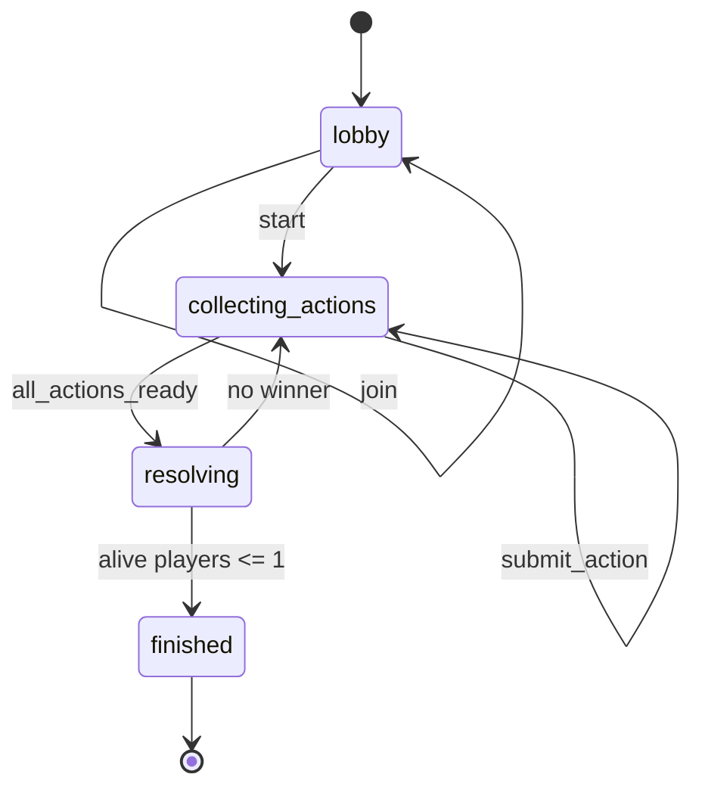
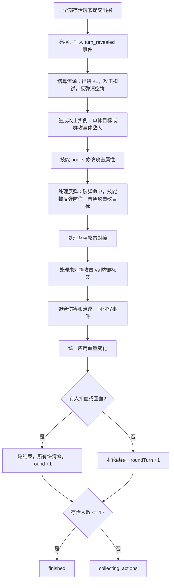

# 《饼》架构设计

## 1. 项目目录结构

```text
bing-card-game/
  apps/
    client/                 # React + TypeScript + Tailwind 前端
      src/
        components/         # 对局 UI、出招面板、日志
        lib/                # Socket 与格式化工具
    server/                 # Node.js + Express + Socket.IO 后端
      src/
        ai.ts               # AI 玩家策略入口
        roomStore.ts        # 内存房间与游戏状态管理
        index.ts            # HTTP/Socket 网关
  packages/
    shared/                 # 前后端共享强类型规则包
      src/
        engine/             # 基础攻击、校验、结算引擎
        skills/             # 技能注册表与 Excel 导入技能库
        state/              # 状态机
        replay/             # Replay 事件导出
        socket.ts           # Socket 通信契约
        types.ts            # 核心类型
  scripts/
    import-skills.py        # 从 docs/archive xlsx 导入技能表
  docs/
    ARCHITECTURE.md
```

## 2. 核心 TypeScript 类型定义

核心类型在 `packages/shared/src/types.ts`，前后端共用，避免协议漂移。

```ts
export type GamePhase = "lobby" | "collecting_actions" | "resolving" | "finished";
export type DefenseKind = "small" | "youtiao" | "stone" | "rebound";
export type DefenseTag = "small" | "youtiao" | "stone" | "any" | "cake" | "unblockable";

export interface PlayerState {
  id: PlayerId;
  name: string;
  kind: "human" | "ai";
  hp: number;
  cakes: number;
  status: "alive" | "dead";
  connected: boolean;
  skills: SkillId[];
  buffs: BuffState[];
}

export type PlayerAction =
  | { type: "gain_cake" }
  | { type: "defense"; defense: DefenseKind; targetId?: PlayerId }
  | { type: "attack"; attackId: AttackId; stacks: number; targetId?: PlayerId }
  | { type: "skill"; skillId: SkillId; stacks: number; targetId?: PlayerId };

export interface GameState {
  id: GameId;
  phase: GamePhase;
  roundNumber: number;
  roundTurnNumber: number;
  turnNumber: number;
  players: PlayerState[];
  pendingActions: Partial<Record<PlayerId, PlayerAction>>;
  eventLog: GameEvent[];
  winnerIds: PlayerId[];
  config: GameConfig;
  createdAt: number;
  updatedAt: number;
}
```

基础攻击定义在 `packages/shared/src/engine/attacks.ts`，叠加时按规则同步放大消耗、攻击力、等级。擒的基础等级是 0，所以叠加后仍然是 0。

## 3. 回合状态机



状态机代码在 `packages/shared/src/state/machine.ts`。

### 技能时点与实际推进

`skills/phases.ts` 定义技能时点的名称，`engine/resolver.ts` 负责实际推进。一回合是一次全员提交、亮招与结算；一轮可以包含多个回合。主出招结算有血量变化时，在回合末行动结束后收束本轮；无血量变化时进入同轮下一回合。轮间技能造成血量变化有单独分支，不能仅用血量变化判断所有窗口都会结束一轮。

| 时点 | 用途或当前例子 |
| --- | --- |
| 开局判定 | 初始血量、开局技能和顺手牵羊候选等初始化 |
| 轮前轮间行动 | 一轮开始前的轮间技能窗口；第一轮允许免费融合及顺手牵羊选择 |
| 轮前行动 | 本轮开始前的主动技能窗口 |
| 轮初判定 | 轮前行动结束后执行独裁、遗计、延迟加饼等轮初效果 |
| 回合前行动 | 每次出招前的主动技能窗口 |
| 回合初判定 | 回合前行动结束后执行圣水收集器、固定出招等回合初处理 |
| 出招阶段 | 玩家提交本回合的出饼、攻击、防御或技能出招 |
| 亮招判定 | 全员提交后公布出招并结算资源 |
| 变招阶段 | 换防、虚幻、双刃剑、绝对守护、毁灭之力等反应窗口 |
| 命中判定 | 实际攻击中的领域、反弹、对撞、防御、免疫及命中效果 |
| 变伤阶段 | 有合法伤害修正技能时，开放十字守护、斗转星移、六芒星等窗口 |
| 伤害判定 | 伤害规则计算与最终血量应用；部分减免已在伤害进入变伤队列前计算 |
| 复活阶段 | 有待处理死亡时开放合法复活技能窗口；部分被动复活立即处理 |
| 回合末行动 | 伤害与复活处理后的主动技能窗口；允许分解融合技能 |
| 回合末判定 | 回合收尾的时点标签；当前主流程未为此单独设置停留窗口或统一技能钩子 |
| 回合后间隙 | 本轮继续时，下一次回合前行动之前的技能窗口 |
| 轮末判定 | 本轮结束时执行圣域、邪域等效果，随后清饼、处理克己、解除轮末失效状态并推进轮数 |
| 轮后轮间行动 | 已定义的轮间时点；当前正常轮末分支直接进入下一轮的轮前轮间行动 |
| 锁定／被动 | 事件驱动的触发类别，不是所有玩家依次进入的独立阶段 |

自动判定标签不都单独写入 `activeTimingPhase`，也不都构成可操作窗口。圣域在 `endRound → applyRoundEndSkills` 中执行，属于轮末判定，不能与每回合的回合末判定混用。正常分支在回合末行动后，有血量变化则执行轮末结算并进入下一轮轮前轮间行动，否则进入同轮回合后间隙。

## 4. 结算流程图



结算主入口是 `submitPlayerAction` 与 `resolveTurn`，位于 `packages/shared/src/engine/resolver.ts`。

## 5. Socket 通信设计

通信契约在 `packages/shared/src/socket.ts`。

| 方向 | 事件 | 作用 |
| --- | --- | --- |
| Client -> Server | `room:create` | 创建房间并绑定当前 socket 的玩家身份 |
| Client -> Server | `room:join` | 加入房间 |
| Client -> Server | `room:add_ai` | 在 lobby 加入 AI 玩家 |
| Client -> Server | `game:start` | 从 lobby 进入收招阶段 |
| Client -> Server | `game:submit_action` | 提交本回合出招 |
| Server -> Client | `room:state` | 广播公开游戏状态，只暴露已提交玩家 id，不泄露未亮出的动作 |
| Server -> Client | `room:error` | 推送错误 |

## 6. 技能系统扩展方案

Excel 技能表已通过 `scripts/import-skills.py` 导入为 `RAW_SKILL_CATALOG`。当前每条技能都有稳定 id、名称、融合方法、描述、标签和来源行号。

融合源数据位于 `docs/archive/技能规范化（v3）.xlsx` 的 Sheet2。导入脚本生成独立的 `generatedFusionCatalog.ts`，保留原基础技能 ID，并为融合产物生成独立 ID。72 条配方均可检索，当前开放 67 条；未开放的配方不能提交融合。文明人相关的三条配方按确认规则开放，聊天触发的效果明确标注待定。火眼金睛已单独按确认的v4描述覆盖为破弹且无视绝弹，不整表导入v4的其他改动。

| 融合 | 已实现效果 |
| --- | --- |
| 交流电、幻境双罩、生死符 | 电击增加 1 次、两种罩各增加 2 次、万箭破弹，保留原素材效果 |
| 极寒风暴 | 狂风骤雪对每个目标造成两段各 2 点伤害，仍共享原来的 2 次上限 |
| 毁灭之盾 | 全力一击基础等级改为 0，被防住反噬 1 血；保留后盾 |
| 神之子 | 天佑之魂按 `abs(hp) * 3 + 6` 结算，保留沐浴圣光 |
| 泣血之刃 | 嗜血回复每次攻击伤害的一半，向下取整；第 4 次复仇胜利 |
| 末世 | 嗜血同上；毁灭之力缩短至每轮 1 次 |
| 风语之森 | 净化之风对所有其他存活玩家各造成 1 点法伤，保留净化免疫和原使用次数 |
| 血魔之怒 | 血水屏障增加 6 防御值；凝血之力移除 4 饼上限，保留原使用次数和轮间限制 |
| 神界炼魂 | 百炼成神的累计攻击要求降至 20 次，原血量条件不变；融合素材中的水晶额外加 1 最终等级 |
| 宗师之力 | 毁灭之力缩短至每轮 1 次；仅被该次毁灭之力修正的攻击无视破地之力 |
| 魔女斗篷 | 暗影盾增加 10 防御值，血水屏障增加 6 防御值；原保护效果和次数不变 |
| 烽火赤壁 | 火烧大地增加 2 次上限；净化之风对所有其他玩家分别造成两段各 1 点法伤 |
| 神域之种 | 神之庇护延长至每轮前 3 回合，融合素材中的水晶提供 2 等级 |
| 虚无 | 闪现缩短至每轮 1 次 |
| 空之轨迹 | 闪现缩短至每 2 轮 1 次，过往时空增加 1 次上限，每次进入小空间 3 轮 |
| 霸者重装 | 圣域每轮触发；融合素材创伤聚合的延迟回血变为 4，轮初加饼和 3 轮等待不变 |
| 冰霜长矛 | 霜落大地自己加 8、他人加 2；寒冰剑保留攻击伤害并使目标技能失效 |
| 水火双生 | 每重杀变为 3 攻、3 级、冰火双属性；寒冰剑保留攻击伤害 |
| 雷霆之心 | 大地之心每次电系免疫回复 4 血，三千雷动目标包含施放者 |
| 逆转星移 | 斗转星移可转移不超过无限的伤害，仍保留原 2 次限制和防循环标识 |
| 斗战胜佛 | 新增金箍棒：3 饼、攻无限、3 级、任意防；保留齐天大圣与火眼金睛 |
| 冰火两仪眼 | 加 4 血、造成冰火伤害并移除其他玩家的冰火素材；每次同时记入火烧和霜落次数，继承已用次数 |
| 虚幻 | 用 1 饼在小防与油条、油条与石头之间切换，替代两种素材控制技 |
| 暗影狙击 | 补刀命中零饼目标时使其退游 |
| 暗影战斧 | 他人每次受伤后按四分之一向下取整回血，自己的伤害不触发 |
| 后羿•七日连珠 | 日命中获得免费日机会，提交时显式指定免费重数；全回合合计校验、防重复花费 |
| 圣灵觉醒 | x 饼获得 4x 饼；受攻击首次归零，已为零时后续伤害照常计算 |
| 阳光之夜 | 两种领域仅作用于自身发出和受到的攻击，额外普通领域副本仍保持全场范围 |
| 破天圣剑 | 忽略配方列明的保护；双刃剑可选 -2 血为指定攻击破弹，保留普通破防选项 |
| 破军 | 双刃剑可选 -1 血群破防；对不低于初始血量一半的目标加 1 攻击伤害 |
| 无尽战刃 | 服务端对实际有限攻击伤害做 1/2 暴击判定，法术伤害不触发 |
| 天火之狱 | 非火系致死时浴火重生消耗 3 饼，地狱主宰自救保留技能、融合和累计次数 |
| 山崩地裂 | 3 饼、5 攻、5 级、饼防；目标出石头时改为退游效果 |
| 绝对天盾 | 绝对守护耗饼按 x/3 下取整，额外可将群攻改为指向天 |
| 神域守护 | 绝对守护耗饼按 x/4 下取整，护佑除 3 下取整、十字乘 3 |
| 黑白板 | 符合胜利人数条件的人数不超过 3 时触发胜利 |
| 冰火双漩 | 3 饼、4 攻、3 级、石头防，连续 1 至 3 个目标，冰火双属性、命中冰冻 2 回合 |
| 冰火狂暴曲 | 替代两份素材，小防、油条、石头混合累计，每3次获得1层冰火印记，上限3层。变招时选择自己的一次攻击，消耗x层，攻等各+x、冰火双属性、命中冰冻x回合；融合清空素材印记和计数，分解清空该融合的印记和计数。熔岩、凛冬、冰火的消耗窗口均可选择攻击，预览与结算使用相同的出招位置。 |
| 空城计 | 遗计中的融合份额轮初改为加3饼；每轮前2回合绝对无敌，完整挡住不高于退游的攻击及后续效果，包含卷子、条件满足的暗影狙击和山崩地裂，且不被青釭、破天穿透。消失及更高等级、非攻击出招、回合或轮间效果不在保护范围内。 |
| 弹力球 | 保留绝弹与散弹，反弹无视破弹。火眼仍可取消绝弹对核爆类、技能出招的反弹许可，这些出招被防住但不反弹；火眼的普通杀仍被散弹反射。 |
| 根源之目 | 保留烈弓和新版火眼金睛，无视弹力球，使破弹重新生效。破弹能力、无视绝弹、无视弹力球分别记录在出招属性中，普通反弹、散弹及逆转后的反弹链复用同一判定。 |
| 大抠天下 | 抠破弹，普天同庆覆盖最远座位 |
| 回响之杖 | 火球保留主伤害 4，第一圈溅射 2、第二圈溅射 1；溅射均可石头防 |
| 永夜之刃 | 对复仇目标的攻击被永远之夜抹除时仍计复仇，普通复仇阈值保持 5 次 |
| 核战 | 每个有效核战对其他玩家减费 3、持有者减费 5，与普通核反应堆叠加，最低为零；覆盖普天盲点 |
| 逐日之弓 | 开局扩充至全场各一项候选，顺手牵羊增加一次选择，保留原已用次数；覆盖普天盲点 |
| 魔域 | 第 3x 轮可在回合末指定三个可重复的其他存活目标，轮末各吸取 1 血；替代两种素材 |
| 电闪雷鸣 | 保留闪电护体和鬼道；每免疫一个攻击增加一次鬼道，同一攻击的多段伤害只计一次，攻击重数不额外增加奖励 |
| 灵魂修复 | 替代创伤聚合和治愈术；第 N 轮受伤，第 N+1 轮轮初加饼、该轮轮末恢复满血，满血值沿用角色初始血量 |
| 枯萎 | 保留血之哀与衰竭；每份在开局选择一个正整数，攻击最终攻击力或等级严格等于所选数字时失效，费用不参与判断 |
| 辉月 | 变招阶段使用，2 轮限 1 次；撤销当前出招，退还实付耗饼并收回出招收益；当前和下一回合不能出招，免疫攻击伤害，不挡法伤或退游，不被青釭剑及破天圣剑穿过；保留神之庇护、替代闪现 |
| 自然之灵 | 保留藤甲与森林的低吟；与圣灵之境共用属性免疫流程，仅免疫火系伤害和效果，包括火烧大地附带的消除冰系技能 |
| 纯净苍穹 | 保留绝对守护与幻防；使用有饼费用的控制技后，本回合免疫新增冰冻、寒冰剑技能失效、麻痹；0 饼仍触发，无耗饼不触发，不解除旧状态 |
| 野蛮人 | 保留素材；每份融合使其逆转总次数从 1 次变为 2 次，继承已用次数；聊天扣血及文明人失效效果待定 |
| 贤者之书 | 保留文明人与卷子，卷子规则不变；文明人的聊天触发 +2 血待定，暂不产生额外效果 |
| 贤者的庇护 | 保留神之庇护与文明人；一局一次，仅自身复活阶段恢复到固定 2 血，沿用治愈术的复活流程；聊天触发 +2 血待定 |
| 杀级换 | 杀换变为无耗饼；级换可交换最终攻击、等级、耗饼数，支持两两交换和三项轮换，按使用顺序计算；变招结束补扣或退还实际差额 |

杀级换的顺序计算与费用预览集中在 `engine/attackStatModifiers.ts`，校验、界面、AI 与命中结算共用。费用取该次出招经过减费后的实际总价；例如神族水晶、酒、核反应堆修正后的核爆为耗 3、攻 7、等 7。强化交换读取当前完整数值；一旦水晶加成被交换，后续属性变化不得再额外补上这份加成。未使用强化交换时，普通毁灭与级换既有的水晶最终加成规则保留。

费用数值和实际付款分别保存：负费用仍以负数参与后续交换或数值检查，付款按 `max(0, cost)`；超过无限的正数进入费用位置统一为无限，不能支付。无耗饼攻击没有费用位置，免费连爆则仍有值为 0 的费用位置。多目标攻击共用预算，按技能使用顺序校验；退费不会提前入账，最终结算还会按剩余饼数复核，失败仅跳过对应交换。原始出招费用和辉月撤销记录同步维护，避免多扣或重复退费。

`turnAttackStats` 为服务端结算缓存，在新回合清除，不投影到公开状态；亮招后只通过 `revealedAttackStats` 提供费用、攻击、等级三个权威数值，不暴露隐藏配方或未亮出的行动。专项回归位于 `scripts/sha-level-regression-check.ts`，随 `npm run test:fusion` 执行。

贤者的庇护拥有独立的限定次数，不消耗额外持有的治愈术；分解、重新融合不刷新已用次数。复活直接恢复到 2 血，沐浴圣光不放大该固定值，血之哀或加血转移不削减复活；现有裂魂禁复活、封印、退游限制继续适用。客户端的复活筛选与 AI 的复活选择同步识别此技能。

`SkillPlayDefinition.cakeCostKind` 区分 `none`（无耗饼）、`fixed`（有固定饼费用，允许为 0）、`dynamic`（按出招或选择计算饼费用，允许结果为 0）。未显式指定时，正数费用默认为 `fixed`，其余默认为 `none`；新增固定 0 饼技能必须显式标为 `fixed`。`skillHasCakeCost` 判断费用性质，实际扣费仍沿用既有费用计算。绝对守护、幻防、虚幻显式标为动态费用，毁灭之力为无耗饼。

`engine/negativeStatuses.ts` 只登记有持续时间的限制类不良；封印、消除技能、夺取技能和扣饼不在其中。新增类别先调用 `registerNegativeStatus({ id, name })`，再通过 `applyNegativeStatus(state, targetId, id, target => { /* 添加或刷新该状态 */ })` 应用，包括替换旧状态的操作也必须放进回调。免疫检查在回调前执行，因此不会删除、刷新或缩短已有不良。状态的持续时间及自然到期仍由其原规则管理；解除不良应独立实现，不能复用免疫接口。纯净苍穹保护持续至本回合末行动结束，进入下一回合前清除。

百炼成神按 `floor(getPlayerInitialHp(player) / 2)` 判断计数门槛，沐浴圣光单份、两份对应的门槛分别为 9、27；原技能仍需 25 次攻击，神界炼魂仍需 20 次。不要使用全局默认 6 血推导所有角色的门槛。

同生共死读取 `damage_taken_turn:<全局回合编号>`，该记录在亮招时重新开始，统计本次出招及后续阶段的实际受伤，防止轮间伤害混入；`damage_taken_round:<轮编号>` 独立保留供凝血之力等轮级效果使用。金钟罩以持有者及 `sourcePlayerId` 标记的对应攻击者区分：每个目标至多一层，受到该目标攻击时只消耗对应护盾，不替换其他目标或其他玩家持有的护盾。

`scripts/skill-scope-regression-check.ts` 覆盖这些计数边界、跨轮保存及独立消耗；随 `npm run test:rules` 一同执行。

辉月使用全局回合编号计算两回合持续时间，跨轮仍持续到下一回合的回合末行动结束。下一回合由引擎自动填入空出招，UI 明示空过，服务端也拒绝手动提交。`turnActionReceipts` 私有记录亮招时每位玩家的实际费用、收益及自身状态变化；辉月只撤销该次出招的记录，阶段技能的额外费用和效果保留，恢复限定次数及鬼道等资源。被取消的普通融合会移除新增覆盖卡，但保留已处理请求 ID，避免重放同一请求。取消事件使用 `action_cancelled` 同步日志、座位反馈和动画。

辉月与闪现共用原三轮冷却账本，按当前副本的 1／2／3 轮冷却时长分配槽位；辉月施放记录绑定其融合来源。融合、分解均不清空账本，额外未融合的闪现副本保留独立三轮槽位。已施放的辉月效果在分解后继续持续，不能借分解绕过下一回合的禁止出招。保护是攻击伤害专用入口，不接入法伤或退游效果的免疫判定，也不读取现有青釭剑和破天圣剑的穿防标记。

结算动画的计时器绑定单次播放会话，独立于后续房间状态更新；连续跳过阶段或自动空过时，已启动的动画仍会按时收尾。辉月浏览器检查同时验证动画浮层消失、手机端空过提示和第三回合恢复提交。

枯萎选数通过 `game:choose_wither_number` 保存，只允许首轮首回合的开局准备窗口，玩家结束准备后不能修改。每份选择默认 1，界面明确显示默认值和保存状态；可以先保存选数、稍后用普通融合行动形成枯萎。`witherSelections` 按玩家私有保存，各枯萎通过 `witherSelectionIndex` 绑定独立选择；其他玩家的公开状态不含选数或私有选择日志。分解不会清空选择，重新融合复用空出的选择位置，中途不能重选。枯萎的新增匹配按数值严格相等计算，选择 2 不会屏蔽攻 12、等 12 的三闪电；在水晶、羽扇等修改后再判断。基础衰竭行为保持不变，触发时仍只暴露衰竭素材，不自动暴露融合产物。

创伤聚合第 N 轮受伤后，在第 N+3 轮轮初加饼、该轮轮末回血；灵魂修复对应第 N+1 轮。轮初是在轮前行动结束后；轮末回血接入与圣域相同的 `applyRoundEndSkills` 节点，每回合普通收尾不会触发。每次实际受伤登记一次，按素材副本计数；轮初支付加饼后保留回血登记，到期轮末结算后移除。灵魂修复保留源伤害对应的原三轮到期账本，持有融合时提前两轮到期；分解后尚未结算的回复恢复原剩余等待和普通回血，已领取的加饼不会重复支付。额外普通创伤副本仍按三轮延迟处理。灵魂修复只作用于存活角色，不能代替复活技救起死亡角色。同一角色在同一轮末先结算延迟恢复，再结算圣域，保留圣域额外回复。

`HealEvent.recoveryKind` 区分普通加血、恢复满血、复活及血量转换。普通加血受不死鸟之眼、制裁之刃和血之哀约束；回满血、绝对值的血量转换，以及治愈术、天佑之魂、离殇、浴火重生、地狱主宰等复活直接修改血量，不参与倍率、禁疗或加血转移。天佑之魂平地使用时仅“+6”走普通加血，绝对值及神之子乘三仍为转换；作为复活使用时“+6”也属于复活。闪电护体在伤害修正窗口之前筛掉被免疫的攻击，并取消其受伤和命中奖励；原“不暴露”设定保留。

费用计算集中在 `engine/actionCosts.ts`，领域判断集中在 `engine/attackFields.ts`。亮招时保存费用快照，避免结算顺序让本回合融合改变已经提交的费用。公开状态只给当前玩家投影其实际单价；亮招后提供实际费用和目标，支持绝对守护等反应界面，同时不公开隐藏配方。`skills/fusionDefinitions.ts` 显式登记融合主动技能。

主动融合技能在注册表中显式提供 `play`，客户端和 AI 使用 `getOwnedSkillIds` 获取素材与融合产物，分解后立即失去产物的施放资格。闪现保留原三轮冷却记录，按当前各副本的 1/2/3 轮冷却回放账本；分解不会清空记录。创伤聚合按融合来源记录延迟回复，额外的普通副本仍加 3 血；分解后尚未结算的强化回复恢复普通数值。

强化效果由共享引擎按融合来源和封印状态计算。额外持有的未融合水晶、嗜血和毁灭之力副本保留原数值。毁灭之力账本仍记录原两轮冷却，按参与融合的副本数量计算冷却缩短；分解恢复原冷却约束，不删除记录。已结算的回血、防御值和累计进度保留，后续施放恢复素材数值。`npm run test:fusion` 验证规则，`npm run test:fusion:ui` 验证浏览器操作、显示和实际护盾效果。

`PlayerState.skills` 保留底层素材槽位，`skillFusions` 记录覆盖它们的融合卡。`getSkillCardIds` 用于展示一张占两槽的融合卡，`getOwnedSkillIds` 用于分别猜测素材和融合产物。累计使用次数、冷却和封印不在融合或分解时重建；次数上限统一通过 `getSkillUseLimit` 读取。冰火两仪眼同时扣除两份素材次数并校验融合前已用次数；带 `sourceFusionId` 和 `fusionMarkKind` 的印记可按来源清理，冰雨印记保留。

公共融合使用 `game:submit_action` 的 `common_fusion` 技能行动，正常出招消耗两饼并等待统一亮招；第一次轮前轮间准备窗口可免费重复使用，与顺手牵羊指定处于同一窗口。分解通过 `game:decompose_skill` 发起，只允许回合末行动窗口，免费且不占出招。客户端生成融合请求 ID，服务器拒绝重复请求。被覆盖的素材不能直接丢弃来绕过分解时机。

公开状态不广播他人的融合记录、请求账本或私有融合日志；亮招仅显示公共“融合”行动，不泄露配方。素材和产物的暴露状态分别记录，猜中任一项不自动暴露其他项。新增效果时应显式开放配方、实现效果并扩展 `npm run test:fusion`，不能仅凭文字推断标记为可玩。

完整复盘、比赛 JSON 和训练样本在对局结束后开放，避免通过导出接口绕过隐藏技能信息。`getAllSkills()` 保持基础技能池兼容；资料和猜测通过 `getAllSkills({ includeFusions: true })` 获取融合目录，原有基础特效清单不被扩充为尚未完成的融合美术资源。

未特别说明的取整默认下取整。六芒星阵采用一次 D12 的互斥概率约定，现已随确认规则的融合批次开放。尚未开放及暂缓效果以 `docs/FUSION_PENDING.json` 为准；不能仅增加到开放名单而跳过对应实现。

技能通过 hooks 接入结算流程：

```ts
export interface SkillHooks {
  validateAction?: (context: SkillContext, action: PlayerAction) => ValidationResult;
  modifyAttack?: (context: SkillContext, attack: AttackStats) => AttackStats;
  beforeDamage?: (context: SkillContext, damage: number, sourceId?: PlayerId) => number;
  afterTurnResolved?: (context: SkillContext) => GameState;
}
```

已经示范接入了两个锁定技：

- `火焰刀`：杀攻 2、等级 2、变火系。
- `朱雀羽扇`：擒攻 4、等级 1、变火系。

未来扩展点：

- AI 玩家：`apps/server/src/ai.ts` 替换为策略树、蒙特卡洛或模型决策。
- 王者卡：作为特殊 `SkillDefinition.category = "king_card"`，通过 hooks 注册主动/被动效果。
- Buff/Debuff：`PlayerState.buffs` 已在状态内预留，可由技能 hooks 增删。
- Replay：所有结算都写入 `GameEvent`，`packages/shared/src/replay/events.ts` 可导出事件帧。
- 天梯：后端 `RoomStore` 可替换成数据库仓储，结算后基于 `GameFinishedEvent` 写排名。

### 散弹与无限份攻击

`engine/scatterRebound.ts` 沿普通反弹追踪第一个可反射当前出招的散弹。实际出反弹且技能生效的散弹者至少两名，或存在另一反弹指回首个散弹者时，分别按散弹者生成无限攻击组；否则向其余玩家各发一份并继续追踪。普通反弹环仍抵消。火眼、绝弹、弹力球与根源的优先级逐节点检查。

无限组使用 `infiniteCopies`，攻击自身威力不变。防御与锁定减伤按单份判断，有限护盾消耗完后仍有无限份；单份变伤操作仅拆出一份。闪电护体保留最低的一发，保留该发的多个伤害段。反弹只转移攻击目标，原攻击发出者不变；普通与无限散弹分别转移为一组或无限组群攻。嗜血、古淀刀、狙击枪及钟、连爆、冰箭雨等命中响应归攻击发出者，受伤者向发出者挂复仇或反伤，反弹者不获得攻击收益。没有绝弹时，钟、冰箭雨、连爆等仅被反弹防住，不转移、不命中。电击法术属于非攻击出招，其麻痹本体仍可转移。

最终发出者与接收者相同的伤害在命中判定前标记为 `internalDamage`：绕过防御出招、防御值、护盾、无敌、闪避与减伤，但参与属性及伤害免疫，不触发帝炎及衍生、红莲斗篷等反伤。全力一击反噬、血水屏障扣血同样走反噬伤害通道。攻击加成与非反伤的受伤响应仍生效，自攻不算补刀；例如自身参与三千雷动也属于反噬伤害，可通过自身电免触发大地之心或雷霆之心奖励。斗转星移仍可转移反噬伤害，转出后重新作为普通法伤结算目标的减伤、免疫及法伤倍率。反噬伤害标记同时进入伤害事件和待伤条目，供日志与变伤窗口展示。

逆转先保存指向性出招及原发出者已有攻击加成，再交换方向，随后复用“反弹追踪 → 对撞 → 命中 → 受伤响应”统一管线，不能先处理反弹再交换。散弹按原群体指向展开为其他玩家各自指向原散弹者的普通反弹。原发出者已用的酒、印记、古淀刀等加成保留，新发出者不追加攻击加成。非指向性出招连同其防御、加饼、治疗和防御印记计数一并取消，耗饼和限定次数按原出招回执退还；偶数次逆转恢复这些回执。第一次逆转立即关闭普通变招，公开字段 `reversalResponseOnly` 只开放逆转响应与跳过，二次逆转不重新开放普通技能，避免退回的饼被中途支出。私有攻击快照与回执 `reversalState` 不投影到客户端；新回合与沦陷重开时清除。新增专项回归入口为 `scripts/rebound-transfer-regression-check.ts`。

无限血与无限鬼道分别使用 `hpIsInfinite`、Buff 的 `infinite` 标记，并保留可序列化的数值占位，避免 JSON 将 JavaScript 的 Infinity 转为 null。当前临时规则由 `engine/infiniteValues.ts` 集中处理：已有正无限血再次承受无限伤害，仍保留无限血。其他无限数值边界待后续统一。

回归入口为 `scripts/scatter-rebound-regression-check.ts`（纳入 `npm run test:fusion`）。生产构建后的四人浏览器检查为 `npx tsx scripts/scatter-browser-check.ts`，结果和截图写入 `artifacts/playtests/`。

## 7. 示例代码

提交动作后，如果所有存活玩家都已提交，服务端立即调用共享结算引擎。

```ts
const result = submitPlayerAction(state, playerId, action);
rooms.set(roomId, result.state);
```

前端不自行判定胜负或伤害，只提交强类型动作。

```ts
socket.emit("game:submit_action", {
  roomId,
  action: {
    type: "attack",
    attackId: "sha",
    stacks: 2,
    targetId
  }
});
```


### 2026-10-30 确认规则的融合

新增开放六芒星阵、博学者之怒、帝灵之境、反伤刺甲、神隐双莲、名刀司命、红莲斗篷、阳炎之怒。开放数量为67/72；红莲斗篷已补全连锁触发，文明人相关聊天效果继续占位。完整剩余清单见 `docs/FUSION_PENDING.json`。

法术伤害通过显式规则名称及 `PendingDamageItem.spellDamage` 标记，与冰、火、电等属性分开。仅按用户列出的九项v4描述更新展示，未整表导入v4。博学者强化法伤，不强化普通属性攻击；森林的低吟只有融合份额翻倍。斗转星移以施放者为新的法伤来源；传音与轮末领域进入共用伤害队列。

六芒星阵每段攻击分别进行D12：1、2获得本回合无敌，3免费执行六芒星效果，4将当前伤害段转回原攻击者，其余正常结算；保留素材已用次数。转回的一段不会吞掉其余伤害段，按原来源对自身的反噬伤害结算，并正常触发原攻击者的命中响应；原目标没有被该段命中。普通反弹与自动反弹均保留原攻击者的古淀刀等增强，反弹者不追加自身攻击加成。八卦阵额外减伤仅作用于融合份额的攻击伤害。

六芒星的治疗总额按本回合最高单次伤害加6计算，0伤害也有基础6血；后续伤害更高时只补差额，不重复增加基础6血。基准记录在本回合六芒星保护状态内，保护持续到回合末行动结束、进入轮末判定前清除。所有治疗通过统一加血入口，受血之哀抑制的额度不会在抑制解除后追补。

反伤按实际受伤逐波继续，死亡时先进入复活阶段，复活后继续；来源最终死亡后的反伤按原规则取消。帝炎之境、帝灵之境、反伤刺甲、红莲斗篷按“玩家ID × 技能ID × 全局回合号”分别最多响应1000次，同名副本共用该技能额度。生成响应即计次，被免疫仍计次；红莲斗篷一次群体火烧计1次。达到上限只停止该技能新增响应，已有伤害、治疗、死亡、复活继续正常结算。帝灵互免在迭代循环内计次至上限，免疫本体不失效；受无限份攻击时，帝炎、刺甲仅生成额度内的有限个独立反伤，保留逐份防御与事件语义。长连锁用迭代处理，不再用第256波创建空伤害窗口的方式间接递归；有实际可用变伤技能时仍开放交互窗口。轮末伤害使用结束中回合的额度，保存收尾进度，复活后不重复支付领域回血或轮末奖励。

响应账本 `GameState.retaliationResponses` 不进入公开投影和先制重开快照，避免泄露隐藏技能与回档刷新次数。帝灵继承的帝炎反伤归入帝灵额度，与新增法伤反击共用；额外未融合帝炎副本单独使用帝炎额度。上限日志使用本次实际展示的响应名称，避免仅展示素材反伤时提前暴露融合。计数独立于玩家buff、限定次数、融合覆盖记录；同回合复活、轮次改变、分解及再次取得同名融合技能均不刷新。只有 `turnNumber` 变化才延迟刷新额度。专项回归为 `scripts/retaliation-response-regression-check.ts`，随 `npm run test:fusion` 执行。

神隐双莲沿用红莲0血检查，负血不触发，下轮初额外加饼。神隐红莲、双莲及红莲斗篷的普通回血走统一加血流程，受血之哀抑制；同一次持续0血状态仅触发一次，恢复正血后再次归零可重新触发，下轮加饼与免费火烧仍独立结算。名刀司命的3至5回合按每轮计数，保护只针对攻击伤害；不死金身同步限定为攻击伤害。红莲斗篷免费调用火烧大地和冰系技能消除，允许其后续伤害引起追加火烧；免费火烧受本技能每回合1000次响应上限限制，普通红莲回血不受该上限限制。

变伤技能移除最后一项待结算伤害后，仍沿原变伤窗口收尾；轮末暂停的结算从保存位置恢复，避免重复结束一轮或重复发放领域回血。六芒星在轮末伤害窗口使用后，也在恢复结算时清理保护，避免跨回合残留。

复核修复的21项回归位于 `scripts/fusion-review-regression-check.ts`，纳入 `npm run test:fusion`；包含六芒星曝光引发传音法伤时，先计算法伤倍率与减伤，再更新治疗基准。

阳炎每份融合独立记录石头/油条混合进度及熔岩，保留额外普通熔岩副本的基础计数与单层+1/+1。融合清空旧普通熔岩和进度，分解或素材移除仅清理该来源的阳炎印记与进度；每层+2/+2仍通过原来的攻击选择窗口使用。


### 2026-10-31 制裁之刃与不死鸟之眼

两项配方已开放，当前共69/72项；两项均保留素材。普通加血先按原受益者持有的有效不死鸟之眼数量乘以2的相应次方，再由唯一有效制裁持有者抢夺；转移后不再套用新受益者的不死鸟倍率。唯一制裁持有者无视全场血之哀。同一玩家的多张制裁视为一个归属方；多名玩家同时持有有效制裁时，新增抢夺与无视血之哀均不生效，保留素材血之哀使普通加血失效；破厄关闭血之哀后普通加血回到原受益者。封印、失效和分解即时改变这些规则。

`engine/healing.ts` 统一计算普通加血的倍率、归属与禁疗；`addHeal` 和保持原时点的 `applyHealNow` 共用该入口。森林、嗜血、六芒星、红莲、圣域、创伤聚合、死神之镰及未激活技能丢弃回血均受影响，不改变原本的触发时点。无限回血保留显式无限标记，不把数值写成JavaScript Infinity。`HealEvent.originalTargetId` 在转移时保留原受益者；日志和动画区分加血、复活、回满血与转换。

所有复活、回满血、制衡等血量直接设置及绝对值转换不进入普通加血入口。天佑之魂仅在平地使用时将“+6”作为普通加血，绝对值转换和神之子乘三仍是转换；有待复活状态时，整个复活（包括+6）均不受倍率、转移或禁疗影响。0血但没有待复活状态的存活玩家属于平地使用。

`scripts/healing-fusion-regression-check.ts` 已接入 `test:fusion`，覆盖39项配方、倍率顺序、多人制裁、封印、分解、普通加血入口、特殊血量处理及0血边界。


### 2026-10-31 八卦阵仅减免攻击伤害

八卦阵基础减伤与六芒星阵强化减伤均按 `isAttackDamage(stats, context)` 判定，只作用于攻击造成的伤害，不作用于法伤、反伤、火球溅射或斗转星移转出的法伤。火、冰、电是独立的属性：火焰刀和熔岩之怒改变属性后的攻击、火球直接命中仍可减伤；反噬伤害仍按原规则绕过八卦阵。六芒星治疗计算中，法伤基准也不再被八卦阵减小。

`scripts/bagua-regression-check.ts` 已接入 `test:rules`，覆盖普通八卦阵、融合强化和额外八卦阵副本的24项攻击/法伤对照；旧逆转与六芒星回归中的法伤预期同步纠正。


### 2026-10-31 攻击伤害、印记与抠反噬修复

攻击只指攻击性出招，其伤害按来源分类，与火、冰、电等属性独立。`isAttackDamageItem` 统一判断待结算伤害的攻击来源；电击法术的内部零伤害包明确不标为攻击。十字守护只在受到攻击伤害时获得护佑和十字印记，护佑/十字和冰雨也只可作用于攻击伤害；冰雨仅能作用于其他玩家发出的攻击。窗口可用性、提交校验、结算和客户端选项遵循同一限制。纯扣血、法伤与非攻击反噬不生成十字印记；由攻击转回自身产生的反噬仍保留攻击来源。

普通圣移除受伤归零效果，齐天大圣与圣灵觉醒保留自身明确描述的归零机制。抠遇到未被破除且指向发出者的反弹时，每次出招对每个符合条件的反弹目标产生一次固定3点反噬；叠招不乘该固定值，绝弹转回的原攻击额外正常结算。破弹成功保留原行为。反噬进入原自身伤害队列，绕过防护、不触发反伤，可正常触发受伤响应与斗转星移。

原“内伤”的显示名统一为“反噬伤害”；保留内部字段 `internalDamage` 和状态ID以兼容现有状态与复盘。变伤窗口再次开放时保留原结算返回位置，防止用完印记后将同一攻击重复结算。`scripts/attack-damage-scope-regression-check.ts` 已接入 `test:rules`，覆盖29项规则与日志显示检查。


### 2026-10-31 冰火法伤、领域吸血与宗师范围

冰火两仪眼的冰火属性与法术伤害分类同时生效，进入博学者之怒的法伤增幅入口。邪域、魔域不再在生成伤害时预先支付固定回血；`PendingDamageItem.drainHealing` 标记该领域伤害，只有最终实际结算为伤害事件时，才按该事件的实际数值生成一次普通回血。博学者增幅伤害后，按增幅后的伤害回血；帝灵免疫、六芒星抵消的部分不回血，斗转星移移除的原伤害也不回血。所得回血继续遵循不死鸟翻倍、制裁抢夺、血之哀禁疗的顺序；多个魔域目标独立处理。轮末复活恢复结算不会重发已经支付的吸血。

双刃剑及破天圣剑、破军的生命支付进入与全力一击、血水屏障一致的反噬伤害入口：绕过防护，不触发反伤，可触发普通受伤响应及斗转星移。描述同步统一“反噬伤害”。宗师之力保持按出招编号保存无视破地的标记，仅毁灭之力选中的攻击受益；同一玩家的其他攻击以及其他玩家的攻击不受益，描述展开说明此范围。

`scripts/spell-drain-regression-check.ts` 已加入 `test:fusion`，覆盖23项法伤增幅、免疫、抵消、转移、回血修正、双刃反噬及同一玩家多攻击的宗师范围验证。

### 2026-11-04 最后三个技能获得型融合与暴露

全部72项融合已开放。`engine/skillAcquisition.ts` 统一处理沙皇、天魔舞与猥琐小叔叔的获得入口，`SkillFusionState.acquisition` 保存每份融合的独立选择和素材次数状态。沙皇有一份普通沙子和一份二融合沙子，各用一次；场上任意存活玩家（含自己）已持有所选技能则失败退游。分解只恢复未使用的沙子，保留变化结果。天魔舞的小技能、二融合镜像各用一次，使用顺序任意；任一使用后消耗原镜像的一次额度，分解保留复制结果，再融合不刷新。不能自我复制沙皇或天魔舞。猥琐小叔叔仅在开局准备选择原素材以外的一个技能，分解移除这个额外技能。

获得二融合时创建完整素材与覆盖关系，保留其完整效果并允许在回合末分解；镜像采用目标实际素材组合。只获得初始能力，不复制目标的封印、使用次数、冷却或印记，也不重置自己原有副本的使用记录。所有已覆盖素材及小叔叔额外技能均从可融合素材池排除，独立的其他副本仍可正常融合。

暴露分为融合卡本体、素材技能原规则和额外效果触发三部分，由 `FUSION_EXPOSURE_TIMINGS` 明确指定；其余融合本体不主动暴露，仍可被猜测。制裁之刃只在夺取他人普通回血时暴露；枯萎只在额外正整数无效化攻击时暴露，普通衰竭触发不暴露枯萎。黑白板在胜利时暴露，核战和逐日之弓形成时宣告。未暴露融合的使用日志仅本人可见。v4 的导入器按列名读取新增编号、暴露列，避免列位移动破坏数据；口头确认的黑白板“胜利时”优先于表内“触发时”。

`scripts/final-three-fusion-regression-check.ts` 已接入 `test:fusion`，覆盖33项独立次数、分解、查重、素材占用、初始化与暴露验证。`scripts/final-three-fusion-browser-check.ts` 校验桌面与390px手机上的三个选择入口，以及通过猜测暴露后复制二融合的完整联机流程。


### 2026-10-31 反噬恢复免疫判定

本节更新此前“反噬绕过所有免疫”的规则：反噬仍不能被无敌、闪避、护盾、防御值或减伤（包括护佑减半）拦截，但恢复各项免疫的原有适用范围。属性免疫、藤甲、不死金身、六芒星、闪电护体及其融合可免疫符合各自条件的反噬。非攻击反噬不会因此获得攻击来源，也不参与只对攻击生效的免疫。反伤仍不响应反噬，普通受伤响应仍按实际受伤触发。

自身电系攻击可以触发大地之心免疫；雷霆之心的三千雷动包含自己时，免疫自身4点电系攻击并正常回复4血。闪电护体将反噬攻击与其他收到的攻击统一比较；电闪雷鸣每免疫一个反噬攻击正常奖励鬼道，无限散弹的免疫仍可奖励无限鬼道。被该免疫剔除的攻击不再触发其命中附加收益。

六芒星主动免疫和持续免疫均覆盖反噬。六芒星阵D12的1/2只获得无敌，不能挡当前反噬；3免费触发六芒星，可免疫并回血；4不会把已经返回自身的攻击重复反弹。已有无敌不阻止反噬触发六芒星阵的免疫概率。

攻击的全局无效化仍先于反弹与命中结算。永远之夜、破地之力、衰竭等先抹除攻击后，不生成反噬、受伤、免疫奖励或该攻击的命中收益。`scripts/backlash-immunity-regression-check.ts` 已接入 `test:fusion`，覆盖37项免疫、非免疫防护、奖励及无效化验证。
